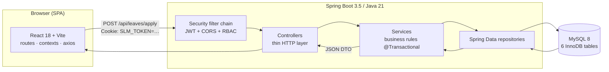
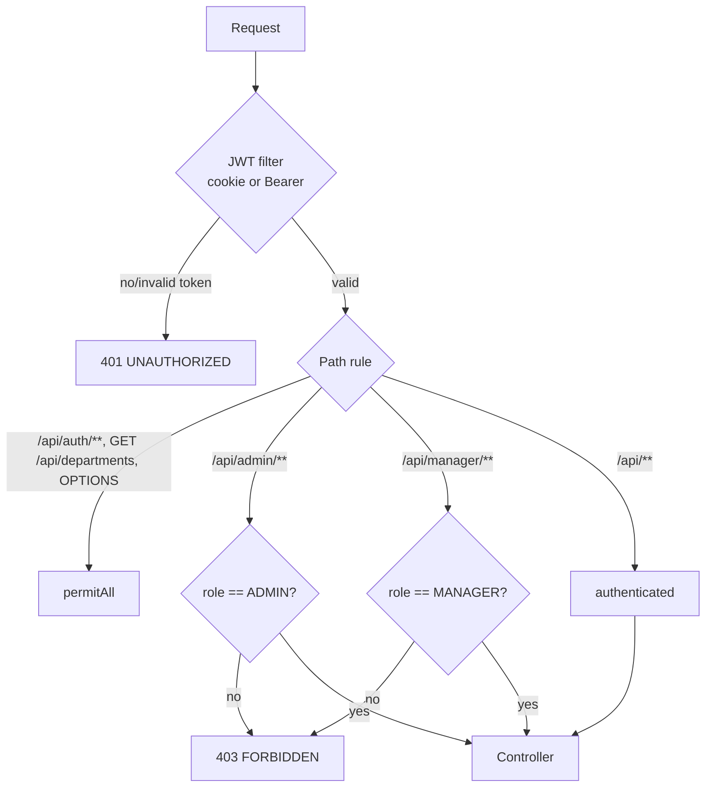
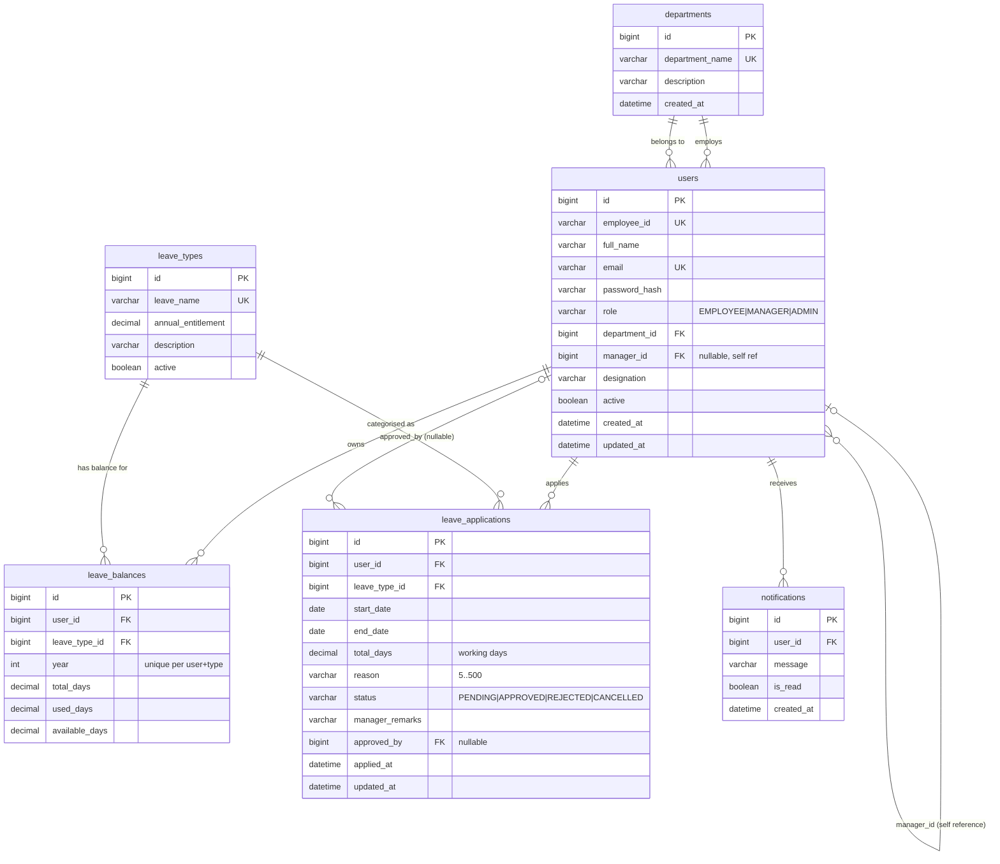
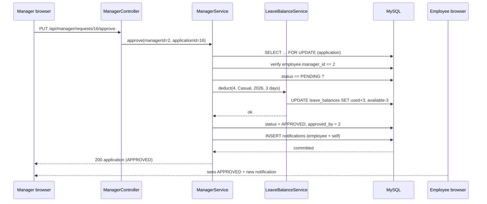
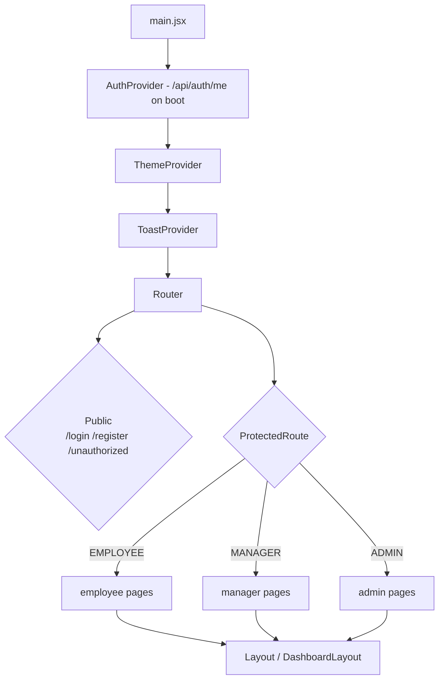

# Architecture

## 1. Big picture

The backend is deliberately layered:

| Layer | Package | Responsibility |
|-------|---------|----------------|
| Controller | `controller` | Map HTTP ↔ DTO, choose status codes, no business logic |
| Service | `service` | All business rules, `@Transactional` boundaries, notifications |
| Repository | `repository` | Spring Data JPA queries (`@Query` for overlap/lock checks) |
| Entity | `entity` | JPA mapping, cascades, `@Version`-free optimistic design with `SELECT … FOR UPDATE` on decisions |
| Security | `security` | JWT issue/validate, `LoggedinUser` principal, filters |
| Exception | `exception` | `ApiException` + `@RestControllerAdvice` producing one error envelope |

Frontend mirrors that idea: `services/api.js` owns HTTP, `context/*` owns global
state (auth, toasts, theme), `pages/*` own screen composition, `components/ui.jsx`
owns presentational primitives.

---

## 2. Security model

* **Stateless** (`SessionCreationPolicy.STATELESS`) — no server session, tokens
  are HMAC-SHA512 signed (JJWT), 24 h expiry, issuer `smart-leave-management`.
* **httpOnly cookie + Bearer**: the SPA never touches the token (XSS-proof
  storage), while Postman/curl use the `Authorization` header.
* **CSRF is disabled** because the cookie is only ever sent to a same-origin API
  with an explicit `Origin` check through CORS, and every mutation is a
  `POST/PUT/DELETE` with `Content-Type: application/json`.
* **CORS allow-list** — an unknown origin gets no `Access-Control-Allow-Origin`
  header at all (verified by the Postman suite).
* **Object-level authorization** in services, not only in the URL rules:
  a manager can only decide requests of direct reports (`assertInsideTeam`),
  and an employee reading `/api/leaves/{id}` of a colleague gets `404` rather
  than `403`, so existence is never leaked.
* **Passwords** are BCrypt-hashed; no plaintext credential exists anywhere.

---

## 3. Database — ER diagram

Notes:

* Invariants such as `available_days = total_days - used_days` are maintained by
  `LeaveBalanceService` (single write path) rather than triggers.
* `leave_applications.status` is a `VARCHAR(20)` mapped to the Java enum
  `LeaveStatus`; decisions use `SELECT … FOR UPDATE` (`findForUpdate`) so two
  simultaneous approvals cannot both succeed.
* The overlap check is a single SQL predicate
  (`start_date <= :end AND end_date >= :start` plus status filter), so rule 9 is
  enforced by the database, not by looping in Java.
* Seed dates are anchored to the **next Monday**, so the demo always shows fresh
  data no matter when it is executed.

---

## 4. Request lifecycle (approve flow)

Everything above happens in **one transaction**: if the balance deduction fails
the whole thing rolls back and the request stays `PENDING`
(`LeaveWorkflowIntegrationTest` asserts exactly that).

---

## 5. Working-day calculation

`util/WorkingDaysCalculator` walks the range and counts only
`MON..FRI` — it is a pure function with a dedicated unit test suite
(half-open ranges, single day, weekend-only, month and year boundaries).
The same rule is used when the SPA previews "Requested duration: 3 working
days", so the client and server always agree.

---

## 6. Frontend architecture

* `ProtectedRoute` renders a redirect (not a blank screen) for wrong roles and
  keeps the requested location so login returns the user to where they were.
* `services/api.js` centralises base URL, JSON headers, 401 → logout handling
  and maps the backend error envelope to a single human-readable message used
  by every toast.
* Theme (light/dark) is the only value in `localStorage`; the session itself
  lives exclusively in the httpOnly cookie.
* Recharts renders the admin reports from `/api/admin/reports`; no chart data is
  fabricated client-side.

---

## 7. Key design decisions

| Decision | Why |
|----------|-----|
| Deduct balance on approval, not on submission | Matches real HR policy and keeps `PENDING` reversible |
| Notifications as rows, not email | Hackathon scope; instant in-app feedback without SMTP |
| Flat DTOs returned by services | Controllers stay trivial; response shape is stable for the SPA and Postman |
| Single error envelope + `code` | The SPA maps `code` to a toast, Postman asserts on it |
| Idempotent SQL seed with `WHERE NOT EXISTS` | Any machine can re-run the seed safely; demo data is reproducible |
| `ddl-auto=validate` | Schema is owned by `database/schema.sql`; Hibernate never mutates it silently |
| Cookie auth for SPA + Bearer for tools | XSS-safe browser session, scriptable API tests |
